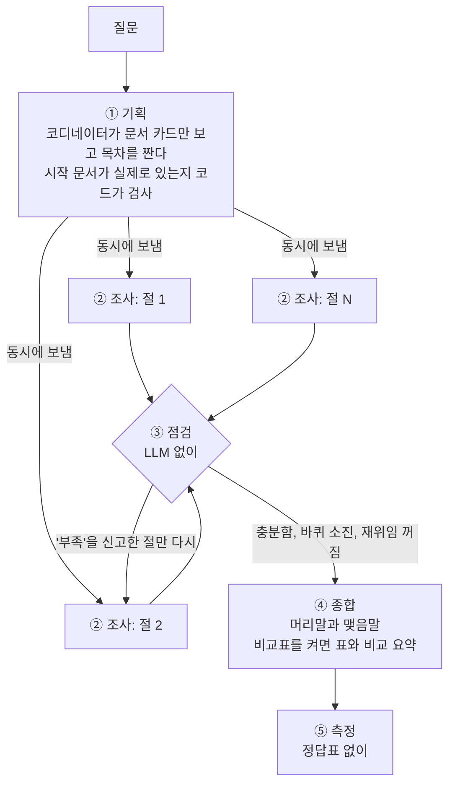

# market-deep-researcher

전기차·배터리 시장조사 질문을 여러 조사관에게 나눠 맡기는 딥리서치 에이전트다.

이 프로젝트가 확인하려던 질문은 **"나눠 맡기면 혼자 쓸 때보다 나은 보고서가 나오는가?"** 이다. 자료(위키 45건, 약 41만 토큰)는 모델이 한 번에 읽을 수 있는 양의 두 배라서 나눠 읽어야 한다. 그런데 나누면 조사관끼리는 서로의 원고를 못 보고, 원고를 모으는 코디네이터도 본문을 읽지 않는다. 절과 절 사이를 이어서 볼 사람이 없어지는 것이다.

실험해 보니 이렇게 나왔다.

- **나누는 것이 이득인 질문은 자료가 회사마다 흩어진 질문뿐이었다.** 한 문서로 끝나는 질문이나 한 대상을 따라가는 질문은 혼자 쓴 쪽이 근거가 더 탄탄했다.
- **나눈 대가도 실제로 나타났다.** 비교를 묻는 질문에 비교가 빠졌고, 질문의 주인공을 벗어난 절은 비었으며, 원문의 주어가 바뀌었다.
- **그래서 대가를 하나씩 메웠다.** 비교표, 주인공 검사, 주체 규칙을 스위치로 더했다.

자세한 설계, 실험, 실패 추적은 [REPORT.md](REPORT.md)에 있고, 진행 기록은 [PROGRESS.md](PROGRESS.md)에 있다.

## 어떻게 동작하나



1. **기획.** 코디네이터가 질문을 보고 목차를 짜고, 절마다 먼저 읽을 문서와 영어 검색어를 정한다. 모델이 지어낸 문서 이름은 코드가 걸러 낸다.
2. **조사.** 조사관들이 동시에 일한다. 조사관은 자기 절에 배정된 문서만 읽고 원고를 쓴 뒤, 끝에 '부족: 예' 또는 '부족: 아니오'를 적는다.
3. **점검.** 코드는 원고를 읽지 않고 '부족' 표시만 보고, 모자란 절만 한 번 더 조사한다.
4. **종합.** 코디네이터는 절 제목만 보고 머리말과 맺음말을 붙인다. 절 본문은 손대지 않고 그대로 싣는다. 코디네이터가 모든 원고를 읽고 다시 쓰면 나눈 의미가 없어지기 때문이다.
5. **측정.** 정답표가 없으니 보고서에 달린 인용과 조사관이 실제로 읽은 기록만으로 잰다 (근거율, 허위 인용, 숫자 불일치 등). 지표는 후보를 알려 줄 뿐이라, 이상하면 사람이 원문과 대조한다.

## 웹 데모

```bash
uvicorn app:app
```

http://localhost:8000에 접속한다.

1. **시장 정하기.** 봇이 목적과 기간을 묻는다.
2. **자료.** 끌어다 놓은 PDF를 쪽 단위로 나눠 조사에 쓴다.
3. **목차 확인.** 조사 전에 사람이 목차를 보고 '예', '빼기 N', '다시' 중에 고른다. 읽을 문서에 질문의 주인공이 거의 나오지 않는 절에는 ⚠가 붙는다. 목차가 틀리면 뒤의 조사가 모두 헛수고라서, 사람이 가장 싸게 바로잡을 수 있는 이 자리에 확인 단계를 두었다.
4. **조사.** 어느 조사관이 무엇을 읽는지 실시간으로 보인다.
5. **보고서.** 인용은 `[1]`처럼 번호로 보이고, 누르면 원문이 뜬다. 마음에 안 드는 문장을 바로 원문과 대조할 수 있다.

화면: [목차 확인](docs/demo/3_목차확인.png), [조사 중](docs/demo/4_조사진행중.png), [비교표와 업로드 자료 원문](docs/demo/7_업로드자료_인용.png), [전체 8장](docs/demo/)

## 실행

```bash
pip install -r requirements.txt
python graph.py "질문" [라벨] [켤 스위치...]    # 예) python graph.py "한국 배터리 3사의 전략 차이는?" ct compare_table
python ablation.py --ids 1 3 7 --repeats 3    # 장치를 하나씩 끄는 실험 (끊기면 --retry-errors)
python compare.py --question-substr "배터리 3사" [--labels base baseline] [--repeat-index -1]   # 보고서를 나란히 읽는 시트
python rescore.py [실행 폴더]                   # 지표 규칙을 바꾼 뒤 이전 실행을 다시 채점 (전후 값을 남긴다)
python metrics.py && python test_compare_table.py   # LLM 없이 도는 검사 (지표, 비교표, 업로드 조각, 주인공 검사)
```

결과는 `output/runs/<시각>_<라벨>/`와 `output/runs.jsonl`에 쌓인다. 실행 폴더에는 목차, 절 원고, 모델 원본 응답, 읽은 문서, 비교 카드, 보고서, 지표가 들어 있다.

LLM은 `config.json`의 `backend`로 고른다.
- `claude_sdk`: Claude Agent SDK. 로컬에 로그인된 Claude Code 계정으로 돈다.
- `openai`: `OPENAI_API_KEY` 환경변수가 필요하다. **키는 저장소에 올리지 않는다** (`.env`는 gitignore).

## 스위치 (`config.json`의 `switches`)

처음 네 개는 분업의 기본 장치다. 나머지는 실험에서 드러난 "나눈 대가"를 메우려고 나중에 더한 것이다.

| 스위치 | 기본 | 켜면 |
|---|---|---|
| `assignment`, `zones`, `redelegation`, `links` | 켬 | 시작 문서 배정, 절끼리 문서가 겹치지 않게 나누기, 모자란 절 재위임, 링크 따라 읽기. `ablation.py`가 하나씩 끄며 잰다 |
| `compare_table` | 끔 | 비교를 묻는 질문에서 비교가 빠지는 문제를 메운다. 조사관이 비교 카드를 붙이면 코드가 표를 만들고, 편집자는 본문 대신 표만 보고 비교 요약을 쓴다 (REPORT 4-4) |
| `uploads` | 끔 (데모는 켬) | 위키에 최신 수치가 없는 문제를 메운다. `data/<시장>/uploads/`의 PDF를 6,000자 이하의 쪽 묶음으로 나눠 자료에 더한다 (REPORT 4-5) |
| `subject_check` | 끔 (데모는 켬) | 주인공을 벗어난 절이 비는 문제를 메운다. 조사 전에 절마다 읽을 문서에 질문의 주인공이 나오는지 센다. 사람이 목차를 보면 ⚠만 붙이고, 사람이 없으면 코드가 뺀다 (REPORT 4-6) |
| `subject_rule` | 끔 | 원문의 주어가 바뀌는 문제를 메운다. 조사관(과 비교 카드, 비교 요약)에게 "원문의 주어를 바꾸지 마라"를 넣는다. 여러 회사를 묶어 말한 문장을 한 회사의 일로 쓰지 않게 한다 (REPORT 4-6) |
| `web_on_question` | 끔 | 아직 쓰지 않는다 (웹 수집 자리) |

나중에 더한 스위치는 모두 기본으로 꺼져 있다. 끄면 프롬프트, 보고서, 읽은 문서가 2차 실험(54회) 때의 코드와 글자 하나 다르지 않다는 것을 가짜 LLM으로 확인했다.

## 파일

| 파일 | 역할 |
|---|---|
| `config.json` | 절 수 상한, 절마다 읽을 문서 수, 바퀴 상한, 수집 틀, 스위치 |
| `llm.py` | LLM 호출을 한곳에서 처리하고, 코디네이터와 조사관이 받은 글자 수를 따로 센다 |
| `graph.py` | 기획, 조사, 점검, 종합 (LangGraph). 비교표, 업로드 조각, 주인공 검사도 여기 있다 |
| `collect.py` | 코퍼스 수집, 업로드 읽기, 링크 생성, 조사할 준비가 됐는지 판정 |
| `metrics.py` | 근거율, 허위 인용, 인용 편중, 중복률, 숫자 불일치, 격리율 |
| `ablation.py` | 스위치를 하나씩 끄고 재는 실험 |
| `baseline.py` | 혼자 쓰는 대조군. 팀과 같은 읽기 예산, 같은 글쓰기 규칙을 쓴다 |
| `compare.py`, `rescore.py` | 보고서를 나란히 읽는 시트, 지표 규칙을 바꾼 뒤 다시 채점 |
| `test_compare_table.py` | LLM 없이 도는 검사 (가짜 `llm.ask`) |
| `app.py`, `static/` | 웹 데모 |
| `docs/demo/` | 데모 화면 캡처 |

## 자료

`data/ev-battery/corpus.json`은 영어 위키백과 문서 45건, 1,631,207자다. 약 41만 토큰으로, Claude가 한 번에 읽을 수 있는 20만 토큰의 두 배다. 문서마다 코퍼스 안의 다른 문서로 가는 링크가 중앙값 12개 있고, 링크가 없는 문서는 없다. 본문의 라이선스는 [CC BY-SA 4.0](https://creativecommons.org/licenses/by-sa/4.0/) (Wikipedia contributors)이다.

처음에는 한국어 위키로 모았는데, 배터리 회사 문서가 1~3천 자로 너무 짧아서(LG에너지솔루션 1,024자) 영어로 바꿨다. 보고서는 한국어로 쓰고 인용만 영어 문서 제목으로 단다.

다시 모으려면 다음을 실행한다.

```bash
python collect.py build ev-battery "Electric vehicle" "Lithium-ion battery" ... --n 45
```

데모에서는 IEA의 *Global EV Outlook 2026*과 *Batteries and Secure Energy Transitions* (CC BY 4.0)를 올려 최신 수치를 보강했다. 파일은 저장소에 올리지 않는다 (`data/*/uploads/`는 gitignore). 받는 곳은 REPORT 4-5에 있다.
