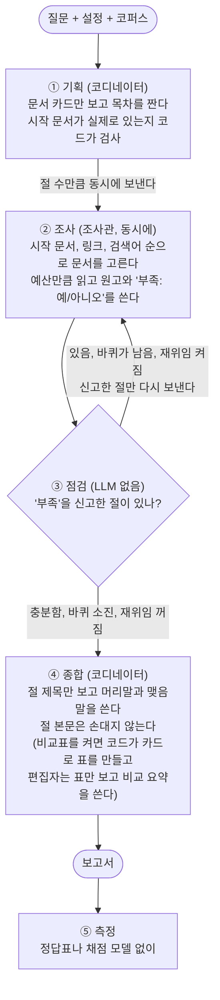

# 전기차·배터리 시장조사 딥리서치 에이전트 보고서

> 2026-09-23 ~ 09-27 작성. "내 판단" 칸은 직접 쓴다 (4-3, 4-4, 4-5, 4-6. Q1과 Q7은 읽기 노트에).

## 들어가며

이 프로젝트가 확인하려던 것은 하나다. **시장조사 질문을 여러 조사관에게 나눠 맡기면, 혼자 한 번에 쓸 때보다 나은 보고서가 나오는가?**

나누면 좋아질 것 같은 이유는 분명하다. 자료가 너무 많아 한 번에 읽을 수 없고, 나누면 조사관마다 자기 몫만 깊이 읽을 수 있다. 하지만 나누는 데는 대가가 있다. 조사관은 서로의 원고를 보지 못하고, 이 프로젝트에서는 원고를 모으는 코디네이터도 본문을 읽지 않게 만들었다. 그러면 절과 절 사이를 이어서 볼 사람이 아무도 없다.

결론부터 적으면 이렇다.

1. **나누는 것이 이득인 질문은 자료가 회사마다 흩어진 질문뿐이었다.** 한 문서로 답이 끝나는 질문이나 한 대상을 시간순으로 따라가는 질문은 혼자 쓴 쪽이 근거가 더 탄탄했다 (4-3).
2. **나눈 대가는 실제로 나타났다.** 세 회사의 전략 차이를 물었는데 팀 보고서는 회사별 설명만 늘어놓고 비교는 하지 않았다 (4-3). 질문의 주인공을 벗어난 절은 근거를 못 찾아 비었고 (4-3), 조사관이 원문의 주어를 바꿔 쓰기도 했다 (4-5).
3. **그래서 대가를 하나씩 메웠다.** 편집자에게 본문 대신 조사관이 만든 표만 보여 줘 비교를 되살렸고 (4-4), 빈 절이 될 절을 조사 전에 걸러 냈으며, 원문의 주어를 지키라는 규칙을 넣었다 (4-6).

정답표가 없는 과제라서 품질은 보고서에 달린 인용과 조사관이 읽은 기록으로만 잴 수 있었다 (3절). 그런데 이 지표도 여러 번 틀렸다. 그래서 숫자가 이상하면 보고서를 직접 읽고, 문제가 된 절, 그 절이 읽은 자료, 코드 순서로 거슬러 올라가 원인을 찾았다. 이 보고서의 발견은 대부분 그렇게 나왔다.

1~2절은 문제와 설계, 3절은 품질을 재는 방법이다. 4-1~4-3절은 만들고 실험하며 얻은 결과이고, 4-4~4-6절은 거기서 드러난 대가를 메운 과정이다. 5절은 사람이 판단에 끼어드는 데모, 6절은 회고다.

## 1. 주제와 자료 — 왜 나눠야 했나

주제는 **전기차·배터리 시장조사**다. "이 시장에서 누가, 무엇으로, 어떻게 경쟁하는가"라는 질문에는 문서 한 건으로 답할 수 없다. 회사, 기술, 소재, 정책 문서를 모두 읽어야 한다. 게다가 질문마다 알맞은 목차가 다르다. 회사별로 나눌 때도 있고 기술별이나 시간순으로 나눌 때도 있다. 목차를 미리 정해 둘 수 없으니, 질문을 보고 목차를 짜는 코디네이터가 필요하다.

자료는 **영어 위키백과 문서 45건, 1,631,207자**다.

- **한 번에 읽을 수 없는 양이다.** 영어는 대략 4자가 1토큰이라 약 41만 토큰이 된다. 사용한 모델(Claude Haiku)이 한 번에 읽을 수 있는 20만 토큰의 두 배다. 이것이 나눠 읽어야 하는 이유다.
- **문서끼리 서로 가리킨다.** 문서마다 코퍼스 안의 다른 문서로 가는 링크가 중앙값 12개 있고, 링크가 없는 문서는 하나도 없다. 조사관은 링크를 따라 다음 문서를 찾을 수 있다.
- **영어를 고른 이유.** 처음에는 한국어 위키로 모았는데 회사 문서가 너무 짧았다. 에코프로 713자, LG에너지솔루션 1,024자, SK온 1,251자, CATL 2,020자였다. 영어 문서는 Tesla가 94,228자, BYD Auto가 94,686자다. 보고서는 한국어로 쓰고 인용만 영어 문서 제목으로 단다.
- **수집하다 겪은 실패.** 처음 모은 자료의 절반이 "영어", "FIFA 월드컵"처럼 주제와 상관없는 문서였다. 주제어가 1,000자당 0.5번 이상 나오는 문서만 남기는 밀도 필터와 시드 제목 검색을 넣어 해결했다.
- **한계.** 백과사전이라 최신 점유율, 가격, 전망이 약하다. 이 약점은 뒤에서 공개 보고서를 올려 보강했다 (4-5).

질문은 10개를 만들었다 (`data/questions.json`). 한 문서로 답이 끝나는 질문 2개, 자료가 여러 갈래로 흩어진 질문 6개, 한 대상을 따라가는 질문 2개다. 질문마다 왜 나눌 만한지(또는 왜 나누면 안 되는지)를 미리 한 줄씩 적어 두었다. 실험에는 세 유형을 하나씩 대표하는 질문 셋을 썼다.

| 번호 | 질문 | 유형 | 미리 적어 둔 이유 |
|---|---|---|---|
| Q1 | CATL은 어느 나라 기업이고 언제 설립됐나? | 한 건 | 나누면 안 되는 예. CATL 문서 한 건으로 답이 끝난다 |
| Q3 | 한국 배터리 3사(LG에너지솔루션·삼성SDI·SK온)의 전략 차이는? | 흩어짐 | 회사마다 문서가 따로 있고 근거가 겹치지 않는다. 회사별로 나누기 좋다 |
| Q7 | BYD는 배터리 회사에서 어떻게 세계적인 전기차 회사가 됐나? | 따라가기 | 한 대상을 시간순으로 따라가며 링크(배터리, 전기차, 해외 진출)를 타야 한다 |

## 2. 분업 설계 — 어떻게 나누고, 무엇을 안 보여 줬나

먼저 이 보고서에 나오는 말을 정리한다.

| 말 | 뜻 |
|---|---|
| 코디네이터 | 질문을 보고 목차를 짠다. 마지막에는 편집자가 되어 머리말과 맺음말을 붙인다 |
| 조사관 | 절 하나를 맡아 배정된 문서만 읽고 원고를 쓴다. 여러 명이 동시에 일한다 |
| 절 | 보고서의 한 부분. 조사관 한 명의 몫이다 |
| 문서 카드 | 코디네이터가 목차를 짤 때 보는 문서 소개. 문서 제목과 본문 앞 150자다 |
| 바퀴 · 재위임 | 조사 한 차례가 한 바퀴다. 원고가 모자란 절만 두 번째 바퀴에서 다시 조사하는 것을 재위임이라 한다 |

설계의 중심은 **코디네이터에게 절 본문을 보여 주지 않는 것**이다. 코디네이터가 모든 원고를 읽고 다시 쓰면 결국 한 사람이 모든 자료를 소화하는 셈이라 나눈 의미가 없다. 코디네이터가 한 번에 읽을 수 있는 양도 금방 찬다. 원고를 고쳐 쓰다 조사관이 달아 둔 인용이 사라질 수도 있다. 그래서 코디네이터는 문서 카드와 절 제목만 보고, 절 본문은 손대지 않고 그대로 싣는다. 이렇게 떼어 놓는 것을 이 보고서에서는 **격리**라고 부르고, 코디네이터가 받은 글자의 비율(격리율)로 잰다.

격리를 지키려면 코디네이터가 하던 판단을 누군가 대신해야 한다. 이 프로젝트에서는 되도록 **코드가** 대신하게 했다.

- **시작 문서 검사.** 코디네이터는 절마다 가장 먼저 읽을 문서를 정한다. 그런데 모델은 그럴듯한 문서 제목을 지어내곤 한다. 그래서 코드가 그 문서가 정말 있는지, 다른 절과 겹치지 않는지 확인한다. 문제가 있으면 다른 문서로 몰래 바꾸지 않고, 경보를 남기고 비워 둔다.
- **구역 나누기.** 동시에 일하는 조사관들은 서로를 보지 못해서 같은 인기 문서로 몰린다 (4-1의 7번). 그래서 조사관을 보내기 전에 코드가 절마다 겹치지 않는 문서 묶음을 나눠 준다. 여기에는 LLM을 쓰지 않는다.
- **점검.** 원고가 충분한지 판단하려면 원고를 읽어야 하는데, 그러면 격리가 깨진다. 그래서 조사관이 원고 끝에 '부족: 예' 또는 '부족: 아니오'를 스스로 적게 하고, 코드는 그 표시만 본다. '부족: 예'인 절만 한 번 더 조사한다 (최대 두 바퀴).
- **두 번째 원고 채택.** 두 번째 원고는 인용 수가 첫 원고 이상일 때만 쓴다. 무조건 덮어쓰면 인용이 빠진 두 번째 원고가 멀쩡한 첫 원고를 지워 버린다.

목차는 코디네이터 프롬프트로 이끈다. 개요, 분석, 전망 같은 형식이 아니라 회사, 기술, 세그먼트 같은 조사 대상 단위로 나누게 하고, 절은 최대 6개지만 칸을 채우려고 절을 만들지는 말라고 한다. 영어 문서를 찾을 수 있게 절마다 영어 검색어도 받는다. 조사관의 읽기 예산은 절마다 문서 3건, 문서마다 앞 6,000자다.

자료 수집과 조사는 나누는 기준을 일부러 다르게 잡았다. 수집은 시장규모, 경쟁사, 규제, 가격, 소비자, 유통이라는 정해진 틀로 넓게 한다. 조사 목차는 질문을 보고 대상별로 짠다. 조사 목차까지 미리 정해 버리면 코디네이터가 할 일이 없어진다.

사람은 **조사 직전의 목차 확인 단계**에서 끼어든다 (5절). 목차가 잘못되면 뒤의 조사가 모두 헛수고가 되므로, 사람이 가장 적은 비용으로 바로잡을 수 있는 자리가 여기다.

실험에서 격리의 대가가 드러난 뒤, 이를 메우려고 스위치 네 개를 더했다. 모두 기본은 꺼져 있다. 끄면 코드가 2차 실험(4-3) 때와 글자 하나 다르지 않게 동작한다는 것을 가짜 LLM으로 확인했다.

| 스위치 | 메우려는 대가 | 방법 | 절 |
|---|---|---|---|
| `compare_table` | 절끼리 비교할 사람이 없다 | 조사관이 원고 끝에 비교 카드를 붙이면 코드가 카드로 표를 만든다. 편집자는 본문 대신 이 표만 보고 비교 요약을 쓴다 | 4-4 |
| `uploads` | 위키 자료에 최신 수치가 없다 | 올린 PDF를 쪽 단위로 나눠 조사 자료에 더한다 | 4-5 |
| `subject_check` | 주인공을 벗어난 절이 빈 절이 된다 | 조사 전에 절마다 읽을 문서에 질문의 주인공이 나오는지 센다. 사람이 목차를 보면 ⚠ 표시만 하고, 사람이 없으면 코드가 뺀다 | 4-6 |
| `subject_rule` | 조사관이 원문의 주어를 바꿔 쓴다 | 조사관과 비교 카드, 편집자에게 "원문의 주어를 바꾸지 마라"를 넣는다 | 4-6 |

## 3. 지표 — 정답표 없이 어떻게 재나

나눈 결과가 좋은지 재야 하는데, 시장조사에는 정답표가 없다. 다른 모델에게 채점을 맡기면 이번엔 그 모델의 판단을 믿어야 한다. 그래서 **보고서에 달린 인용과 조사관이 실제로 읽은 기록만** 본다. 지표는 두 종류다. 경보는 0이어야 하는 것이고, 신호는 높고 낮음을 견주는 것이다. 경보도 확정이 아니라 **사람이 확인할 후보**로 다룬다.

| 지표 | 종류 | 계산 | 값이 나쁘면 볼 곳 |
|---|---|---|---|
| 허위 인용 | 경보 | 인용했는데 읽은 기록에 없는 문서 | 조사 프롬프트 |
| 숫자 불일치 | 경보 (후보) | 문장 속 숫자가 그 문장이 인용한 원문에 없음 | 조사 프롬프트. 단어로 쓴 수("five or six")와 한국어 단위로 바꾼 수("1 billion"을 "10억"으로)는 아직 잘못 잡으니 사람이 확인한다 |
| 무효 시작 문서 | 경보 | 코디네이터가 지어낸 문서 제목 | 기획 프롬프트, 문서 카드 |
| 인용 없는 절 | 경보 | 원고에 인용 «»이 하나도 없음 | 목차, 문서 배정 |
| 비교 카드 누락 | 경보 (비교표를 켰을 때) | 원고에 비교 카드가 없거나 축 이름이 맞지 않음 | 조사 프롬프트 |
| 요약의 표 밖 인용 | 경보 (비교표를 켰을 때) | 비교 요약에 표에 없는 인용이 있음 | 편집자 프롬프트 |
| 근거율 | 신호 | 인용이 붙은 문장 수 / 전체 문장 수 | 조사 프롬프트 |
| 인용 편중 | 신호 | 가장 많이 인용된 문서가 전체 인용에서 차지하는 비율 | 절이 문서 하나에만 기대는지 |
| 중복률 | 신호 | 1 − (서로 다른 문서 수 / 읽은 횟수) | 문서 배정과 구역 |
| 격리율 | 신호 | 코디네이터가 받은 글자 / 전체 글자 | 편집자가 본문을 보면 올라간다 |

지표가 틀리면 그 위에 세운 결론도 틀린다. 실제로 지표는 여러 번 틀렸다. 보고서를 직접 읽다 이상한 점을 발견하면 규칙을 고쳤고, 고칠 때마다 2차 실험 54회를 `rescore.py`로 다시 채점해 전후 값을 남겼다 (`output/ablation_rescored.json`).

| 고친 규칙 | 발견한 곳 | 54회 중 값이 바뀐 실행 |
|---|---|---|
| 제목 줄은 문장으로 세지 않는다. "Inc." 같은 약어의 마침표에서 문장을 자르지 않는다 | 4-3 Q3 보고서 읽기 | 근거율 54회 모두 (순위는 그대로) |
| 표는 칸 하나를 한 문장으로 센다 | 4-4. 모든 칸에 인용이 있는 가짜 표가 0.43으로 나왔다 | 0 (이전 보고서엔 표가 없다) |
| "B.V.", "U.S." 같은 약어에서 자르지 않는다 | Q7 읽기 노트 | 근거율 13회 (모두 Q7, 0.01~0.04 오름) |
| 원문의 "5 percent"를 "5%"와 같게 본다 | 4-4, 4-5 경보를 원문과 대조 | 숫자 경보 23회 |
| 인용 제목은 자르거나 바꾸지 않는다 («Tesla, Inc.»가 «Tesla, Inc»로 바뀌어 원문을 못 찾았다) | 4-4 Q7 실험 | 숫자 경보 3회 |
| 한 괄호에 두 문서를 묶은 «A, B»는 나눠서 본다 | 4-5 업로드 실행 (읽은 문서가 허위 인용으로 잡혔다) | 0 |
| 인용 제목 안의 숫자(«… 2024 p25-26»)는 세지 않는다 | 4-6 업로드 실행 | 0 |
| 읽은 조각 안의 한 쪽(«… p98», 읽은 것은 «… p97-98»)은 그 조각으로 본다. 조각 밖의 쪽이나 원문 속 참고문헌 표기는 계속 경보 | 4-6 후속 실험 | 0 |
| 영문자에 붙은 숫자(V2G, M3P)는 세지 않는다 | 4-6 후속 실험 | 숫자 경보 1회 |
| 원문에서 숫자와 '%' 사이에 공백이나 줄바꿈이 있어도 같게 본다 (웹 페이지는 "86.8"과 "%"가 다른 칸이다) | 4-7 데모 | 0 |
| 0을 뺀 소수(".71", ".432~.924")의 마침표에서 문장을 자르지 않는다 (논문식 표기. 잘린 조각에 인용이 없어 숫자 경보가 됐다) | 4-7 데모 | 0 |

그 결과 54회의 숫자 경보는 실행 당시 78건에서 지금 31건으로 줄었다. 근거율은 "B.V." 규칙 뒤로 바뀌지 않았다.

## 4. 파이프라인 구조

| 상태 값 | 여러 조사관의 결과를 합치는 방법 | 쓰는 단계 |
|---|---|---|
| `plan` | 덮어쓴다 | 기획 |
| `axes` | 덮어쓴다. 비교축 (비교표를 켰을 때만) | 기획 |
| `drafts` | `keep_better`. 두 번째 원고는 인용 수가 첫 원고 이상일 때만 채택하고, 읽은 기록은 쌓는다. 절마다 비교 카드(`card`)도 함께 둔다 | 조사 |
| `round`, `stop_reason` | 덮어쓴다 | 기획, 점검 |
| `alarms`, `log` | 이어 붙인다 | 모든 단계 |

격리율은 `llm.ask(coord=True/False)`가 코디네이터와 조사관이 받은 글자를 따로 세서 계산한다. 격리율 = 코디네이터 글자 / (코디네이터 글자 + 조사관 글자).

## 4-1. 만들면서 부딪힌 실패 여덟 가지 (2026-09-23)

파이프라인을 처음 만들 때 Q3를 다섯 번 돌리며 고쳤다. 매번 보고서를 직접 읽고, 이상한 대목이 있으면 그 절의 원고, 그 절이 읽은 문서, 코드 순서로 거슬러 올라갔다.

| # | 보고서에서 본 증상 | 거슬러 올라가 찾은 원인 | 고친 방법 |
|---|---|---|---|
| 1 | 본문에 "머리말과 맺음말을 작성하겠습니다", "자료를 검토했습니다" 같은 말이 섞였다 | 삼성SDI와 SK온 절의 원고(`sections/*.md`)부터 이미 섞여 있었다. 조사 프롬프트가 이런 말을 막지 않았다 | 프롬프트로 막고, 제목과 구분선을 지우는 후처리를 더했다 |
| 2 | 삼성SDI와 SK온 절 본문에 "자료가 부족하다"고 썼는데 재위임이 되지 않았다 | '부족' 신고를 원고의 마지막 40자에서만 찾았는데, 모델은 신고를 본문 앞쪽에 썼다 | 원고 전체에서 찾게 했다 |
| 3 | 같은 보고서인데 근거율이 32.1%에서 37.0%로 바뀌었다 | 보고서는 그대로이고 문장을 나누는 규칙만 바꿨다 (마침표 뒤의 인용을 앞 문장 것으로 보게). 지표 규칙만 바꿔도 점수가 달라진다는 것을 이때 처음 겪었다 | 이후 비교는 모두 새 규칙으로 다시 채점했다. 고치기 전 기록은 `_debug_runs_before_metric_fix.jsonl`로 따로 뒀다 |
| 4 | 숫자 불일치 경보가 14건 나왔다 | 12건이 날짜였다. 보고서는 "2021년 10월 1일", 영어 원문은 "October 1, 2021"이라 숫자 모양이 달랐다 | 날짜와 서수는 검사에서 뺐다 (14건에서 2건으로) |
| 5 | 재위임 바퀴에서 세 절이 모두 Hyundai와 Kia 문서를 읽었다 | 절 제목은 한국어, 문서는 영어라 단어 겹침 점수가 늘 0이었다. 그래서 링크 순서대로 문서를 집었고, GM 문서의 링크가 Hyundai와 Kia로 이어졌다 | 코디네이터가 영어 검색어를 주게 하고, 검색어 점수를 먼저 보고 링크는 점수가 같을 때만 보게 했다 |
| 6 | 멈춘 이유가 "내용 충분"인데 로그에는 모든 절이 '부족'을 신고했다 | 채택되지 않은 두 번째 원고의 '부족' 표시를 `keep_better`가 지웠다 | 표시를 남겨 "바퀴 소진"으로 정직하게 기록되게 했다 |
| 7 | 재위임된 세 절이 같은 문서 3개를 읽었다 (중복률 50%) | 동시에 일하는 조사관은 서로를 보지 못해 같은 인기 문서로 몰렸다 | 구역을 켜서, 조사관을 보내기 전에 코드가 문서를 겹치지 않게 나눠 준다 (중복률 0%) |
| 8 | 종합 단계에서 "Reached maximum number of turns (1)" 오류가 났다 | Agent SDK의 `allowed_tools=[]`는 자동 승인 목록일 뿐 도구는 그대로 보여서, 모델이 도구를 불렀다 | `tools=[]`로 내장 도구를 없애고, 실패하면 한 번 더 시도하게 했다 |

이 과정에서 두 가지를 배웠다.

첫째, **경보는 확정이 아니다.** Q7 데모 실행에서 숫자가 든 인용 15개를 원문에서 찾아보니 15개 모두 있었다. 숫자 불일치 경보 6건 가운데 "원가 5~6배"는 원문이 숫자가 아니라 "five or six times"라는 단어로 적혀 있었다.

둘째, **격리의 대가가 처음 보였다.** 같은 보고서에서 1절은 BYD 창업자를 "왕추안푸", 2절은 "왕전부"로 적었다. 둘 다 Wang Chuanfu다. 절을 따로 쓰고 편집자는 본문을 읽지 않으니, 절끼리 어긋나도 잡을 사람이 없다.

목차도 매번 흔들렸다. 같은 Q3에서 절 수가 3, 5, 5, 3으로 바뀌었고, Q1은 3, 1, 1이었다. Q7의 5절 가운데 "글로벌 전기차 시장의 성장"은 BYD가 아니라 주변 시장을 다룬 절이었는데, 이 절이 스스로 '부족'을 신고했다. 질문의 주인공을 벗어난 이런 절을 이 보고서에서는 **밖으로 벌린 절**이라고 부른다. 4-3과 4-6에서 다시 나온다.

## 4-2. 1차 실험 — 대조군이 불공정했다 (반복 1회, 참고용)

파이프라인이 돌아가자 장치를 하나씩 끄면 무엇이 달라지는지, 혼자 쓰는 대조군과는 어떻게 다른지 쟀다. Q1, Q3, Q7에 대해 기본 설정, 스위치 4개를 하나씩 끈 설정, 혼자 쓰는 대조군을 한 번씩 돌렸다. 18회 중 16회가 성공했다 (2회는 주간 사용량 한도에 걸렸다).

아래 근거율은 실행 당시 규칙의 값이다. 1차 결과는 비교에서 뺐기 때문에 다시 채점하지 않았다. 4-3의 숫자와 바로 견주면 안 된다.

| 설정 | 근거율 | 인용 편중 | 중복률 | 격리율 | 호출 |
|---|---|---|---|---|---|
| 기본 | 0.56 | 0.55 | 0.00 | 0.08 | 8.3 |
| 배정 끔 | 0.53 | 0.63 | 0.00 | 0.14 | 7.7 |
| 구역 끔 | 0.47 | 0.60 | 0.26 | 0.16 | 6.0 |
| 재위임 끔 | 0.69 | 0.46 | 0.00 | 0.12 | 5.7 |
| 링크 끔 | 0.43 | 0.69 | 0.00 | 0.21 | 4.5 |
| ~~대조군~~ | ~~0.22~~ | | | 1.00 | 1.0 |

구역을 끄자 중복률이 0에서 26%로 올랐고 (Q7은 50%), 재위임을 끄자 오히려 근거율이 올랐다 (0.69 대 0.56). 같은 Q1 기본 설정 안에서도 근거율이 0.25에서 0.77까지 흔들려서, 한 번 돌린 결과로 순위를 매길 수는 없었다.

가장 큰 문제는 **대조군**이었다. 대조군이 읽은 24건이 코퍼스에 저장된 순서와 거의 같았다. 한국어 질문으로 영어 문서의 점수를 매기니 모두 0점이 나왔고, 결국 앞에서부터 차례로 집은 것이다. 그래서 Q3(한국 3사)를 묻는데 LG Chem 문서를 읽지 않았다. 게다가 팀은 코디네이터가 영어 검색어를 주는데 대조군에는 그런 기회가 없었고, 인용을 다는 위치 같은 글쓰기 규칙도 달랐다. 대조군의 0.22는 공정한 비교가 아니었다.

그래서 대조군도 팀과 같은 문서 카드를 보고 먼저 읽을 문서와 검색어를 스스로 고르게 하고, 글쓰기 규칙도 팀과 같게 맞췄다. 1차 결과는 `output/ablation_run1_unfair_baseline.json`에 남기고 비교에서는 뺐다.

## 4-3. 2차 실험 — 나누면 언제 이득인가 (반복 3회, 54회 모두 성공)

대조군을 공정하게 고친 뒤, 같은 세 질문을 여섯 가지 설정으로 세 번씩 모두 54회 돌렸다. 6회는 세션 사용량 한도로 끊겨 같은 코드, 같은 모델로 다시 돌렸다 (`ablation.py --retry-errors`). 원자료는 `output/ablation.json`이고, 보고서를 나란히 놓고 읽는 시트는 `output/compare/`에 있다 (`python compare.py --question-substr BYD`).

### 팀과 혼자

| 질문 | 미리 적어 둔 이유 | 근거율 팀 | 근거율 혼자 | 문장 수 팀 / 혼자 | 호출 팀 / 혼자 |
|---|---|---|---|---|---|
| Q1 CATL (한 건) | 나누면 안 되는 예 | 0.61 (0.57~0.62) | **1.00** (1.00~1.00) | 8 / 40 | 3 / 2 |
| Q3 한국 3사 (흩어짐) | 회사마다 문서가 따로 있다 | **0.78** (0.73~0.83) | 0.67 (0.62~0.71) | 26 / 26 | 8.3 / 2 |
| Q7 BYD (따라가기) | 한 대상을 시간순으로 따라가야 한다 | 0.88 (0.86~0.90) | **0.97** (0.91~1.00) | 42 / 40 | 8 / 2 |

근거율과 문장 수는 지금 규칙으로 다시 채점한 값이다 (3절). 실행 당시 규칙으로는 팀이 0.40, 0.64, 0.74, 혼자가 0.86, 0.53, 0.80이었다. 값은 모두 올랐지만 세 질문 모두 팀과 혼자의 순서는 같다.

**질문을 설계할 때 적어 둔 이유가 결과와 맞았다.** 나누는 것이 근거율을 올린 건 자료가 흩어진 Q3뿐이었다. Q1처럼 한 문서로 끝나는 질문과 Q7처럼 한 대상을 따라가는 질문에서는 혼자 쓴 쪽이 근거가 더 탄탄했다. 혼자 쓴 보고서가 짧아서 근거율이 높은 것도 아니었다. 문장 수가 같거나(Q3, Q7) 오히려 다섯 배 길었다(Q1). 대신 팀은 호출이 3~4배, 시간이 약 3배 들었다 (Q3 기준 215초 대 63초). 1차 실험의 불공정한 대조군(0.22)과 견주면, 대조군 조건을 맞추는 것만으로 결론이 뒤집힌 셈이다.

### 장치를 하나씩 끄면 (9회 평균)

| 설정 | 근거율 | 인용 편중 | 중복률 | 호출 | 빈 절 |
|---|---|---|---|---|---|
| 기본 | 0.76 | 0.61 | 0.00 | 6.4 | 4 |
| 배정 끔 | 0.75 | 0.67 | 0.00 | 7.4 | 4 |
| 구역 끔 | 0.80 | 0.58 | **0.27** | 6.3 | 1 |
| 재위임 끔 | 0.69 | 0.52 | 0.00 | 5.9 | 4 |
| 링크 끔 | 0.76 | 0.57 | 0.00 | 6.9 | 2 |

근거율은 지금 규칙의 값이다. 실행 당시 규칙으로는 차례로 0.59, 0.60, 0.65, 0.53, 0.61이었다.

구역을 끄면 중복률이 0에서 27%로 올랐지만 (Q3 45%, Q7 36%) 근거율은 그대로였다. 구역은 같은 문서를 여러 번 읽는 낭비를 줄이는 장치이지, 품질을 올리는 장치는 아니었다.

근거율로 설정의 순위를 매길 수는 없었다. 같은 설정 안에서의 흔들림(Q1 구역 끔 0.67~0.87, Q3 재위임 끔 0.20~0.85)이 설정끼리의 차이(0.69~0.80)보다 컸다.

재위임이 도움이 되는지도 확인하지 못했다. 가장 나쁜 보고서(Q3 근거율 0.20)가 재위임을 끈 설정에서 나오긴 했지만 단 한 번이었고, 빈 절 수는 기본 설정과 같았다 (4 대 4). 재위임을 켜도 두 바퀴 모두 실패한 경우가 많았다는 뜻이다. 그래서 가장 나쁜 보고서 한 건을 추적했다.

### 가장 나쁜 보고서를 추적하다 — 빈 절은 어디서 오나

Q3 재위임 끔 3회차, 근거율 0.20(실행 당시 규칙으로는 0.10)인 보고서다.

1. 보고서: 인용이 붙은 문장이 하나뿐이고, 세 절 가운데 두 절이 제목만 있고 비어 있었다.
2. 절 원고(`sections/*.md`): 두 절의 원고가 0바이트였다.
3. 목차(`plan.json`): 회사별이 아니라 기술 포트폴리오, 고객사 확보, 글로벌 경쟁력으로 나눈 기능별 목차였다. 형식으로 나눈 목차에 가깝다.
4. 읽은 문서(`visited.json`): 시작 문서가 LFP 배터리, Hyundai, CATL이었다. 한국 3사 이야기가 없는 문서들이다.
5. 점검: 재위임을 꺼 두어 두 번째 기회가 없었고, 빈 절이 그대로 실렸다.
6. 경보: "인용 없는 절" 경보는 울렸다. 지표가 이 실패를 잡은 것이다.

같은 증상을 54회 전체에서 찾아보니 인용 없는 절 15건(1건을 빼면 원고가 0바이트)이 **모두 밖으로 벌린 절**이었다. '고객사 포트폴리오', '글로벌 경쟁', '북미 규제', '수직통합'처럼 질문의 주인공이 아니라 주변 주제를 맡은 절이었고, 그 절이 읽은 문서에는 주인공(BYD, 한국 3사)이 나오지 않았다. 재위임을 켜도 대부분 두 바퀴 모두 실패해 "바퀴 소진"으로 끝났다.

원인은 코드 버그보다 **목차와 문서 배정**에 있었다. 그래서 세 가지를 바꿨다. 데모에 목차 확인 단계를 넣어 사람이 조사 전에 절을 뺄 수 있게 했다. 인용이 없는 절은 본문에서 빼고, 맺음말에 "자료 부족으로 다루지 못한 절"로 밝히게 했다. '부족: 예' 표시가 든 줄 전체를 지우던 정리 코드를 표시만 지우게 고치고, 모델의 원본 응답을 `sections/*.raw.txt`로 남기게 했다 (이번에는 원본 응답이 없어서 이 버그가 빈 절에 영향을 줬는지는 확인하지 못했다). 빈 절이 될 절을 조사 전에 자동으로 걸러 내는 방법은 4-6에서 시도했다.

### 내 판단 (`output/compare/*.md` 를 나란히 읽고)

**Q3 한국 3사 — 팀(base) vs 혼자(baseline), 반복 0** · 읽기 노트: `output/compare/Q3_읽기노트.md`

- **보고서라면 혼자 쓴 쪽의 비교 내용이 무조건 들어가야 한다.** 질문이 "전략 차이"인데 팀 보고서는 회사별로 따로 정리만 하고 세 회사를 나란히 놓지 않았다 (점유율 · 생산기지 · 차세대 기술 · 고객사가 절마다 흩어져 있고, LG vs SK 소송은 아예 없다)
- **고칠 방향**: 팀 조사관들이 조사한 내용은 그대로 쓰고, 편집자는 그걸 보고 판단해서 사람이 보기 쉽게 **표 같은 양식**으로 정리해야 한다
- **근거율과 내용의 저울질은 판단하기에 정보가 부족하다.** 팀은 근거율이 높고, 혼자는 핵심 사실(소송)이 하나 더 있지만 원문에 없는 인용(기술 라이센싱)도 한 문장 있다 — 이것만으로는 어느 쪽이 낫다고 말할 수 없다
- 팀 보고서의 근거 없는 문장이 왜 생겼는지 궁금해서 추적 → 11문장 중 5개는 제목 줄, 1개는 "Inc." 에서 잘린 문장이었다 (지표 버그, 고친 뒤 54회 재채점 — 순서는 그대로). 진짜 근거 없는 주장은 2문장

**Q1 · Q7** (읽기 노트: `output/compare/Q1_읽기노트.md` · `Q7_읽기노트.md`)

- Q1 CATL: **둘 다 비슷**
- Q7 BYD: **판단 보류**

이 판단에서 다음 작업이 나왔다. 팀 보고서에 비교가 빠진 것은 조사관이 자기 절만 보고 편집자는 본문을 보지 않는 격리 구조 때문이다. 격리를 지키면서 비교를 되살리는 방법을 4-4에서 시도했다.

## 4-4. 비교표 — 끊긴 연결을 표로 잇기 (Q3, 반복 3회, 2026-09-24)

4-3의 판단은 "비교 내용이 들어가야 하고, 편집자가 그것을 표 같은 양식으로 정리해야 한다"였다. 그런데 편집자가 절 본문을 읽고 표를 만들면 격리가 깨진다. 그래서 **조사관이 원고 끝에 비교 카드를 붙이고, 코드가 카드를 모아 표를 만들고, 편집자는 본문 대신 이 표만 보게** 했다 (스위치 `compare_table`).

1. 코디네이터가 목차와 함께 절들이 공유할 **비교축** 3~5개를 정한다. 비교할 질문이 아니면 빈 목록을 낸다.
2. 조사관은 본문을 지금처럼 쓰고, 그 뒤에 비교축마다 한 줄씩 비교 카드를 붙인다. 줄마다 인용을 달고, 자료가 없으면 "자료 없음"이라고 쓴다.
3. 코드가 카드로 표를 만든다. 행은 비교축, 열은 절, 칸은 카드 한 줄 그대로다.
4. 편집자는 표만 보고 비교 요약을 3~5문장 쓴다. 요약에 표에 없는 인용이 있으면 경보를 남긴다.
5. 보고서는 머리말, 비교표와 비교 요약, 절 본문, 맺음말 순서가 된다.

같은 Q3를 세 설정으로 세 번씩, 모두 9회 돌렸다. base는 스위치를 끈 설정(2차 실험과 같은 코드), compare_table은 이 스위치만 켠 설정, baseline은 혼자 쓰는 대조군이다. 대조군의 읽기 예산은 같은 회차의 base가 읽은 문서 수와 같게 맞췄다.

- 재현: `python graph.py "한국 배터리 3사(LG에너지솔루션·삼성SDI·SK온)의 전략 차이는?" compare_table compare_table` (셋째 인자부터가 켤 스위치다)
- 나란히 읽기: `python compare.py --question-substr "배터리 3사" --labels base compare_table baseline --repeat-index -1` (-3, -2, -1이 이번 실험의 1, 2, 3회차다)

### 먼저 지표를 고쳤다

표를 예전 규칙으로 세면 머리 행과 구분선(`|---|`)이 "근거 없는 문장"이 되고, 칸이 마침표마다 제멋대로 잘린다. 모든 칸에 인용이 붙은 가짜 표로 재 보니 근거율이 1.00이 아니라 0.43으로 나왔다. 그래서 칸 하나를 한 문장으로 세고, 머리 행, 구분선, 축 이름, "자료 없음" 칸은 세지 않게 고쳤다. 54회를 다시 채점해도 바뀐 실행은 없었다. 이전 보고서에는 표가 없었기 때문이다.

### 첫 시도는 버그 두 개 때문에 무효로 했다

첫 실행(`0924-151905_compare_table`, 기록 라벨 `compare_table_bug1`)의 보고서를 읽고 실험을 멈췄다.

1. **목차가 기능별로 바뀌었다.** 비교축을 달라는 요청이 목차까지 끌어당겨, 절이 회사가 아니라 "기술 로드맵, 고객 포트폴리오, ESS, 생산 거점"이 됐다. 4-3에서 빈 절을 낳던 바로 그 모양이다. 네 절 모두 첫 바퀴 원고가 비었고, 한 절은 끝까지 비어 빠졌다. 표도 기능과 기능을 교차한 모양이라 회사끼리 비교할 수 없었다.
2. **카드를 읽는 코드가 칸을 놓쳤다.** 코디네이터가 축 이름을 `배터리 기술 포지셔닝(고성능/고밀도 vs …)`처럼 길게 지었는데, 조사관은 `배터리 기술 포지셔닝:`으로 줄여 쓰거나 `리튐`처럼 오타를 냈다. 이름이 정확히 같아야만 받던 코드가 15칸 중 7칸을 비웠다. 실제로는 카드 줄이 있었다.

코디네이터 프롬프트에 "비교축은 목차가 아니다, 축 이름은 괄호 없이 짧게"를 넣었다. 카드를 읽는 코드는 축 이름을 괄호 앞까지만 맞추고, 카드 줄만 떼어 낸 뒤 나머지는 모두 본문으로 남기게 고쳤다 (카드를 본문 앞에 써도 본문이 사라지지 않게). 같은 원본 응답을 새 코드로 읽으면 15칸이 모두 찬다. 재위임 때 원본 응답을 덮어써 첫 바퀴 빈 원고의 원인을 볼 수 없었기에, 원본 응답을 바퀴마다 쌓아 두게도 바꿨다. 이후 3회는 고친 코드로 돌렸다.

### 결과 (3회 평균, 괄호는 범위)

| 설정 | 근거율 (보고서 전체) | 근거율 (표와 요약 빼고) | 문장 | 격리율 | 코디네이터가 받은 글자 | 호출 | 시간 |
|---|---|---|---|---|---|---|---|
| base | 0.77 (0.71~0.82) | 0.77 | 29 | 0.090 | 8,354 | 7.3 | 151초 |
| compare_table | 0.91 (0.88~0.93) | 0.85 (0.80~0.90) | 38 | 0.134 | 9,587 | 6.7 | 194초 |
| baseline | 0.69 (0.55~0.95) | — | 22 | 1.000 | 99,123 | 2 | 38초 |

이번 base와 baseline은 2차 실험의 값(0.78, 0.67)과 비슷하다. 보고서 전체의 근거율은 compare_table에 유리하다. 표 칸과 요약 문장에는 거의 모두 인용이 붙어 있기 때문이다. 그래서 절 본문끼리 비교하려면 "표와 요약 빼고" 칸을 봐야 한다.

격리율은 0.090에서 0.134로 올랐다. 편집자가 더 받은 글자는 평균 1,233자로 표와 요약 지시문뿐이다. 절 본문은 여전히 보지 않는다. 호출은 요약 1회가 늘었고 (절이 3개인 회차끼리 견주면 6회에서 6~7회), 시간은 43초 늘었다. base 2회차는 절이 5개라 호출이 10회였다.

### 표가 생겼고, 인용도 지켜졌나

| 회차 | 목차 | 코디네이터가 정한 비교축 | 채운 칸 | 인용 붙은 칸 | 요약 문장 | 요약의 표 밖 인용 | 카드 경보 |
|---|---|---|---|---|---|---|---|
| 1 | LG, 삼성, SK | 주력 배터리 기술, 주요 OEM 고객, 글로벌 생산거점, 차세대 기술 투자, 시장 점유율 | 12/15 | 12 | 5 | 0 | 0 |
| 2 | LG, 삼성, SK | 주요 자동차 고객, 배터리 기술 포트폴리오, 글로벌 생산 거점, 차세대 기술 전략, 가격/성능 포지셔닝 | 10/15 | 10 | 3 | 0 | 0 |
| 3 | LG, 삼성, SK | 고객사 포트폴리오, 배터리 기술 노선, 글로벌 거점 전략, 원재료 확보 방식, 차세대 기술 개발 | 10/15 | 10 | 4 | 0 | 0 |

표는 세 번 모두 생겼다. 채운 칸 32개에는 모두 인용이 있다. "자료 없음"이 몰린 축은 '가격/성능 포지셔닝'과 '원재료 확보 방식'(둘 다 3회 모두)으로, 위키 자료에 없는 내용이었다. 절 본문은 9회 모두 조사관 원고와 글자 그대로이고 (코드로 대조), 표 45칸도 모두 카드 한 줄 그대로다. 요약의 인용은 모두 표 안에 있었다.

그 밖에 확인한 사실은 다음과 같다.

- 스위치를 켜면 기획 프롬프트가 달라지므로 목차도 달라진다. 세 번 모두 절 제목이 회사 이름뿐이었다. base의 절 제목은 "○○의 △△ 전략" 꼴이었고, base 2회차에는 회사를 가로지르는 절 2개가 붙어 5절이 됐다.
- 숫자 불일치는 처음에 compare_table 4.7, base 2.3이었다. 표와 요약에서 나온 4건은 원문이 "5 percent", "7 per cent"로 적은 것을 잘못 잡은 것이었고, 칸 내용은 원문과 맞았다. 숫자 검사를 고친 뒤 다시 세면 compare_table 1.3, base 1.0, baseline 0.7이다.
- SK 절은 재위임 바퀴에서 원고가 비었다 (base는 3회 모두, compare_table은 2회). 모두 첫 원고가 남아 있어서 보고서에 빈 절은 없었다.
- 4-3에서 혼자 쓴 쪽에만 있던 LG와 SK의 소송은 세 설정 모두 세 번 중 한 번(3회차)씩 나왔다. compare_table에서는 SK 절 본문에만 있고, 비교축으로 뽑힌 적이 없어 표에는 없었다.

### 비교할 질문이 아니면 어떻게 되나 (Q1, Q7 각 3회, 2026-09-24~25)

데모에서 비교표를 기본으로 켤지 정하려면, 비교할 질문이 아닐 때 표가 보고서를 망치지 않는지 알아야 했다. 2차 실험의 같은 질문 base 3회와 견줬다 (스위치를 끄면 코드가 같다).

| 질문 | 설정 | 표 | 절 | 근거율 (표와 요약 빼고) | 빈 절 | 격리율 | 호출 | 시간 |
|---|---|---|---|---|---|---|---|---|
| Q1 CATL (한 건) | base | — | 1, 1, 1 | 0.61 | 0 | 0.309 | 3.0 | 69초 |
| Q1 | compare_table | 1/3 | 1, 1, **4** | 0.57 (0.55) | 1 | 0.249 | 4.3 | 164초 |
| Q7 BYD (따라가기) | base | — | 4.3 | 0.88 | 2 | 0.072 | 8.0 | 187초 |
| Q7 | compare_table | **3/3** | 4.3 | 0.95 (0.93) | 0 | 0.091 | 8.7 | 306초 |

- Q1은 두 번이 비교축을 빈 목록으로 내서 표가 생기지 않았고, 보고서 모양도 그대로였다. 한 번은 비교축 5개(설립국가, 설립연도 등)와 함께 목차까지 4절로 쪼개져, 빈 절이 하나 생기고 호출 7회, 328초가 들었다. 스위치를 끈 base는 세 번 모두 1절이었다.
- Q7은 세 번 모두 표가 생겼다. 그런데 열이 회사가 아니라 단계나 주제(배터리 기초, 자동차 진출, LFP, 글로벌)여서, 표는 "BYD의 시기별 모습"이 됐다. '글로벌' 열의 칸은 BYD가 아니라 CATL과 Tesla 이야기였다.
- Q7 한 번은 편집자가 표 칸의 인용 대신 열 이름(절 제목)을 출처처럼 달았다 («배터리 기업으로서의 BYD 기초 및 경영 전략»). 허위 인용 경보 3건과 "요약의 표 밖 인용" 경보가 모두 이를 잡았다.
- Q7은 시간이 119초 늘었다. 요약 호출이 하나 늘고, 카드가 붙어 원고가 길어졌기 때문이다.

### 보고서를 읽으며 본 점

- 1회차의 '시장 점유율' 행에서 LG는 "2011년 말 기준 세계 3위", 삼성과 SK는 "2022년 상반기" 값이다. 한 행 안에 기준 연도가 섞여 있다. 요약은 LG를 빼고 삼성과 SK만 비교했다.
- 요약에 표에 없는 평가가 섞인다. 1회차의 "29개 사업소로 가장 광범위"(칸마다 단위가 다르다. 사업장 29곳 대 공장 6곳)와 2회차의 "특정 고객에 집중"이 그렇다. 인용 검사로는 잡히지 않는다.
- 요약은 칸 여러 개를 한 문장으로 합치면서 인용 2~3개를 한꺼번에 붙이는 경우가 많다.
- 표 칸에도 "LG에너지솔루션은 … «LG Chem»" 같은 주어 혼동이 그대로 옮겨진다 (Q3 읽기 노트 5번). 이 문제는 4-6에서 다룬다.

### 판단을 돕는 질문

1. 4-3에서 혼자 쓴 쪽이 비교한 항목(점유율, 생산기지, 차세대 기술, 고객사, 소송) 가운데 표에 들어간 것과 빠진 것은 무엇인가? 빠진 소송을 넣으려면 비교축을 정하는 기획과 카드 중 어디를 고쳐야 할까?
2. 표가 생긴 대신 편집자가 받은 글자가 늘었다 (격리율 0.090에서 0.134로). 이 정도의 격리 손실은 받아들일 만한가?
3. 비교 요약은 표 칸을 거의 그대로 이어 붙였다. 요약이 있는 편이 나은가, 표만 있는 편이 나은가?
4. 표 칸 하나가 사실 한 문장이라 행마다 기준 연도와 단위가 섞인다. 읽는 사람이 표만 보고 결론을 내려도 될까?

### 내 판단 (직접 쓰기)

- 비교표가 4-3에서 말한 "비교 내용"을 채웠나:
- 어느 쪽이 나은가 (base / compare_table / baseline): **판단 보류**
- 이유 (자기 말로):
- 마음에 안 드는 칸 → 어느 절 → 어느 자료:

## 4-5. 공개 보고서 업로드 — 최신 수치 보강 (2026-09-24~25)

회고(6절)에서 고른 또 하나의 약점은 위키 자료에 최신 수치가 없다는 점이다. 그래서 IEA의 공개 보고서 두 건(CC BY 4.0)을 데모의 업로드 폴더(`data/ev-battery/uploads/`, git에는 올리지 않는다)에 넣었다.

- *Global EV Outlook 2026* (2026년 6월, 295쪽, [PDF](https://iea.blob.core.windows.net/assets/857aa690-2a43-453f-9f12-147cc8f0a1dd/GlobalEVOutlook2026.pdf))
- *Batteries and Secure Energy Transitions* (2024년 4월, 159쪽, [PDF](https://iea.blob.core.windows.net/assets/cb39c1bf-d2b3-446d-8c35-aae6b1f3a4a0/BatteriesandSecureEnergyTransitions.pdf))

받은 파일 이름(`IEA Global EV Outlook 2026.pdf`, `IEA Batteries and Secure Energy Transitions 2024.pdf`)이 그대로 인용 제목이 된다. 원래 코퍼스 파일(`corpus.json`)은 건드리지 않고 불러올 때만 합친다. 스위치 `uploads`는 기본으로 꺼져 있고 데모에서만 켠다.

### 올린 PDF가 조사에 쓰이기까지 고친 다섯 가지

PDF를 올리기만 해서는 조사관이 읽지 않았다. 데모를 세 번 돌리면서 막힌 곳을 하나씩 뚫었다.

| # | 증상 | 원인 | 고친 방법 |
|---|---|---|---|
| 1 | 올린 PDF를 조사관이 한 번도 읽지 않았다 | 업로드는 데모의 "자료 점검" 숫자에만 더해지고, 조사는 `corpus.json`만 읽었다 | 조사 자료를 불러올 때 업로드도 합치게 했다 (`load_corpus(uploads=True)`) |
| 2 | PDF를 통째로 합치면 조사관은 앞 6,000자, 즉 표지와 목차만 읽는다 | 문서마다 앞 6,000자만 읽는 예산 | PDF를 쪽 단위로 모아 6,000자 이하의 조각 230개로 나눴다. 조각 제목은 `파일명 p98-99`로 했다. `p.98`처럼 마침표를 넣으면 문장을 나눌 때 인용이 두 동강 난다 |
| 3 | PDF를 읽는 데 1분이 걸렸다 (pypdf) | — | pymupdf로 바꿔 두 파일에 3.5초가 걸린다. 폴더가 그대로면 다시 읽지 않는다 |
| 4 | 첫 실행에서 코디네이터가 받은 글자가 54,869자(보통은 9천 자)로, 격리율이 0.394까지 올랐다. 3사가 모두 나오는 GEVO p97-100은 어느 절도 읽지 않았다 | 조각 230개를 모두 문서 카드로 보여 줬다. 또 검색어 점수를 문서 앞 2,000자로만 매겼는데, 위키 문서의 요약 문단에 맞춘 규칙이라 회사 이름이 둘째 쪽에 있는 조각은 0점이 됐다 | 코디네이터에게는 파일마다 한 줄만 보여 주고, 조각은 조각 전체로 점수를 매겼다 (위키 문서는 그대로) |
| 5 | 둘째 실행에서 격리율은 0.098로 돌아왔지만, IEA 조각을 하나도 읽지 않았다 | 코디네이터가 검색어를 "LG Energy Solution battery chemistry"처럼 긴 구절로 줬다. 구절 전체가 그대로 있어야 점수가 난다 | 업로드가 있을 때만, 검색어에 대상 이름을 원문 표기 그대로 짧게(예: 'SK On') 넣으라는 한 줄을 더했다 |

첫 실행에서 LG 절의 두 번째 원고는 IEA를 인용했다 ("2025년 한국 전기차 판매 약 65% 성장, 20만 대 초과"). 하지만 첫 원고보다 인용 수가 적어 채택되지 않았다. 4-4에서 원본 응답을 바퀴마다 쌓아 두게 바꾼 덕분에 이것을 알 수 있었다.

### 세 번째 실행 결과 (`output/runs/0924-174308_demo`, 비교표 켬)

| | 첫 실행 | 둘째 실행 | **셋째 실행** |
|---|---|---|---|
| 읽은 IEA 조각 | 4 (재위임 바퀴에서만) | 0 | **4 (세 절 모두 첫 바퀴에)** |
| 보고서의 IEA 인용 | 0 | 0 | **11** (GEVO p145-147 9번, p95-96 2번). 그중 비교표 칸 3개 |
| 근거율 | 0.90 | 0.88 | 0.89 |
| 격리율, 코디네이터가 받은 글자 | 0.394, 54,869 | 0.098, 9,567 | 0.173, 10,002 (재위임이 없어 조사관 글자가 적다) |
| 호출, 시간 | 8회, 308초 | 8회, 236초 | 6회, 148초 |

원문과 대조해 확인한 새 사실은 이렇다.

- 한국 생산업체들은 미국 확장을 GM, Ford, Stellantis와의 제휴에 기대 왔기 때문에, 이 완성차 회사들이 전동화 계획을 줄이면 더 큰 영향을 받는다 (GEVO 2026 p145).
- Panasonic은 한국 3사가 미국 생산을 늘리면서 점유율을 잃었다 (p145).
- 2025년에 LGES와 Ford 등의 설비 50GWh 이상이 LFP 생산으로 바뀌었고, 주로 에너지저장(ESS) 시장을 겨냥했다 (p96).
- 한국 업체들이 파우치 셀을 고른 것은 스마트폰 산업과 함께 성장했기 때문이다 (p146).

원문과 어긋난 문장도 있었다. 지표로는 잡히지 않아 사람이 대조해서 찾았다.

- 원문은 "**한국 생산업체들**의 미국 확장은 GM, Ford, Stellantis와의 제휴에 기댄다"고 했는데, 보고서는 "**SK온은** … GM, Stellantis 등과의 전략적 파트너십"이라고 썼다 (비교표 칸에도). 원문의 "LGES**와 Ford 등**"의 50GWh는 보고서에서 "LG에너지솔루션은 … 50GWh"가 됐다. 여러 회사를 두고 한 말을 한 회사의 일로 좁힌 것이다.
- 위키 쪽에서는 원문의 "2022년 **상반기**"가 보고서에서 "2022년 **1분기**"가 됐다. 날짜는 숫자 검사에서 빼기 때문에 잡히지 않았다.
- 숫자 불일치 경보 6건은 모두 "5 percent", "7 per cent" 같은 단어 표기를 잘못 잡은 것이었다. 숫자 검사를 고친 뒤 다시 세면 0건이다.

### 같은 설정으로 세 번 더 (2026-09-24~25)

세 번째 실행에서만 된 것인지 확인하려고, 업로드와 비교표를 켠 설정으로 Q3를 세 번 더 돌렸다.

| | 4-4 compare_table (업로드 없음) | 업로드 + 비교표 |
|---|---|---|
| IEA 조각을 읽은 수와 인용 수 | — | 6과 9, 2와 5, 4와 9. **세 번 모두 인용** |
| 근거율 (표와 요약 빼고) | 0.91 (0.85) | 0.88 (0.81) |
| 격리율 | 0.134 | 0.148 |
| 호출, 시간 | 6.7회, 194초 | 6.7회, 300초 (1회는 컴퓨터 절전이 끼어 뺐다) |
| 숫자 불일치, 허위 인용 | 1.3, 0 | 1.0, 0 |

세 번째 실행에서만 되던 것이 세 번 모두 됐다. 읽힌 쪽은 GEVO p95-100(LFP 전환, 수익성), p145-147(한국 업체의 미국 의존), Batteries p61-64(LGES 폴란드 공장, 리튬 투자)였다.

원문이 "한국 업체들"로 뭉뚱그려 말한 사실(파우치 셀 선택, GM·Ford·Stellantis와의 제휴, 50GWh 전환)을 한 회사의 일로 옮겨 쓴 문장을 원문과 대조해 셌더니, 세 번에 8건이었다 (본문 4, 표 칸 3, 비교 요약 1). 묶음을 그대로 지킨 문장은 1건뿐이었다. 이 문제는 4-6에서 규칙을 넣어 다시 쟀다.

한 괄호에 두 문서를 묶은 인용(«Samsung SDI, IEA … p145-147»)도 처음 나왔다. 둘 다 읽은 문서인데 허위 인용 경보가 울려서 지표를 고쳤다 (3절).

### 판단을 돕는 질문

1. IEA 두 건이 더해진 보고서는 4-4의 compare_table 보고서보다 최신 수치 면에서 나아졌나? 무엇이 새로 들어왔고, 무엇이 여전히 없나 (최신 점유율 등)?
2. 원문이 "한국 업체들"이라고 뭉뚱그린 것을 조사관이 한 회사에 붙였다. 조사 프롬프트를 고칠 일인가, 읽는 사람이 원문 패널로 확인하면 되는 일인가?
3. 올린 조각을 찾게 하려고 검색어 규칙까지 바꿔야 했다. 쪽 조각과 검색어로 찾는 이 방법이 데모에서 쓸 만한가, 아니면 절마다 업로드 문서를 한 건씩 꼭 읽게 하는 편이 나은가?

### 내 판단 (직접 쓰기)

- 

## 4-6. 밖으로 벌린 절과 주어 바꿈 줄이기 (2026-09-25~27)

지금까지 드러난 문제 가운데 두 가지를 스위치로 줄여 보았다.

첫째는 4-3에서 확인한 **밖으로 벌린 절**이다. 질문의 주인공을 벗어난 절은 읽은 문서에 근거가 없어 비었다. 회고에서 보완하고 싶은 점으로 고른 것이기도 하다.

둘째는 4-4, 4-5와 읽기 노트에서 사람이 원문과 대조해 찾은 **주어 바꿈**이다. 두 종류가 있었다.

- **뭉뚱그린 주어를 한 회사로 좁히기**: 원문은 "한국 업체들"이라고 했는데 보고서는 "SK온은"이라고 쓴다.
- **옛 회사의 일을 새 회사 이름으로 쓰기**: 원문의 주어는 LG Chem(1999년)인데 보고서는 "LG에너지솔루션은 1999년…"이라고 쓴다. LG에너지솔루션은 2020년에 세워졌다.

### B. 주인공 검사 (`subject_check`)

**근거.** 2차 실험 54회의 절 149개를 다시 보았다. 각 절이 첫 바퀴에 읽을 문서 3건에 질문의 주인공(Q1은 CATL, Q3는 3사와 모회사, Q7은 BYD)이 몇 번 나오는지 셌다.

| 첫 바퀴 문서 3건에 주인공이 나온 횟수 | 절 | 그중 빈 절 |
|---|---|---|
| 1번 이하 | 58 | **15 (빈 절 전부)** |
| 2번 이상 | 91 | 0 |

빈 절 15개는 모두 주인공이 1번 이하로 나오는 절에 있었고, 2번 이상 나오는 절에서는 빈 절이 하나도 없었다. 조사 전에 이것만 세어도 빈 절이 될 절을 미리 알 수 있다는 뜻이다.

**동작.** 코디네이터가 목차와 함께 주인공 이름을 적는다. 약칭, 옛 이름, 모회사 이름까지 적게 하고, 어느 문서에도 없는 이름은 코드가 거른다. 그다음 조사 전에, LLM 없이, 절마다 첫 바퀴에 읽을 문서에서 주인공이 몇 번 나오는지 센다. 1번 이하면 "벌린 절 후보"로 표시한다.

- 사람이 목차를 보는 경우(데모)에는 그 줄에 "⚠ 읽을 문서에 주인공 언급 0회 — 빼기 권장"만 붙인다. 뺄지는 사람이 정한다.
- 사람이 없는 경우(실험)에는 코드가 빼고, 보고서 끝에 "조사 전에 뺀 절: …"로 밝힌다.
- 모든 절이 후보라면 다 뺄 경우 보고서가 없어지므로 빼지 않고, 코디네이터에게 목차를 한 번 다시 짜게 한다.

**만들면서 찾은 설계 실수 세 가지.** 실험하다 멈추고 고쳤다. 그때의 실행은 기록에 `subject_check_v0`~`v2` 라벨로 남기고 결과에서는 뺐다.

| 판 | 증상 | 원인 | 고친 방법 |
|---|---|---|---|
| v0 | Q3에서 기능별 5절이 모두 후보(언급 0번)였는데 그대로 조사해 빈 절 2개, 호출 12회가 나왔다 | "모든 절이 걸리면 이름이 틀린 것"이라고 가정했다. 실제로 이름은 맞았고 목차가 문제였다 | 모든 절이 걸리면 목차를 한 번 다시 짜게 했다 |
| v1 | Q3에서 LG에너지솔루션 절이 빠졌다 | 주인공을 "LG Energy Solution"으로만 받았다. LG 절이 읽는 «LG Chem» 문서에는 그 표기가 1번 나온다 ("LG Chem"은 23번) | 옛 이름과 모회사 이름도 받게 했다 |
| v2 | Q7에서 LFP 절이 빠졌다 | 정식 명칭("BYD Company")만 받아서, LFP 문서에 "BYD"로 2번 나온 것을 0번으로 셌다 | 약칭도 받게 했다 |

**결과.** 최종판으로 세 질문을 3회씩 돌려 2차 실험의 base 3회와 견줬다.

| 질문 | 설정 | 남은 절 | 조사 전에 뺀 절 | 빈 절 | 근거율 | 호출 | 시간 |
|---|---|---|---|---|---|---|---|
| Q1 | base | 1.0 | — | 0 | 0.61 | 3.0 | 69초 |
| Q1 | 주인공 검사 | 1.0 | 0 | 0 | 0.59 | 3.0 | 71초 |
| Q3 | base | 3.7 | — | 2 | 0.78 | 8.3 | 215초 |
| Q3 | 주인공 검사 | 3.3 | 1 | 1 | 0.75 | 5.7 | 216초 (절전이 낀 1회는 뺐다) |
| Q7 | base | 4.3 | — | 2 | 0.88 | 8.0 | 187초 |
| Q7 | 주인공 검사 | 3.0 | **3 (세 번 모두 '글로벌 시장' 절)** | 0 | 0.86 | 5.0 | 211초 |

- Q7은 세 번 모두 '글로벌 전기차 시장 진출', '글로벌 시장 경쟁', '전기차 시장 경쟁' 절을 조사 전에 뺐다. Q7 읽기 노트에서 "BYD 이야기가 없다"고 짚었던 바로 그 절이다. 빈 절은 2개에서 0개로, 호출은 8회에서 5회로 줄었다.
- Q3는 두 번이 회사별 3절 목차라 후보가 없었다. 한 번은 5절 가운데 '배터리 기술 포지셔닝'을 뺐지만, 검사를 통과한 '자동차 제조사 고객사 전략'이 결국 빈 절이 됐다. 놓친 절이 하나 있었던 것이다 (아래 후속에서 추적했다).
- Q1은 영향이 없었다. 최종판 9회에서 목차를 다시 짠 경우는 없었다.
- 호출은 줄었지만 시간은 줄지 않았다.
- 데모의 목차 확인 단계에서는 이 검사를 켜 두었다 (`app.DEMO_CFG`).

### A. 주체 규칙 (`subject_rule`)

조사관(과 대조군)에게 한 줄을 더했다. "원문의 주어를 바꾸지 마라. 여러 회사를 묶어 말한 내용은 한 회사가 한 일처럼 쓰지 말고 묶음 그대로 써라. 옛 회사나 모회사를 지금 회사 이름으로 바꿔 쓰지 마라."

주어 바꿈은 지표로 잡을 수 없어서 사람이 원문과 대조해 셌다.

- **옛 회사의 일을 새 회사 이름으로**: LG에너지솔루션(2020년 12월 설립)이 그보다 이른 연도와 함께 «LG Chem»을 인용한 문장, SK온(2021년 10월 설립)이 그보다 이른 연도와 함께 «SK Innovation»을 인용한 문장을 후보로 뽑고 하나씩 확인했다. 여러 회사가 나오는 문장은 연도가 누구 것인지 알 수 없어 뺐다. 예: "LG에너지솔루션은 1999년 한국 최초로 리튬이온 배터리를…", "SK온은 … 2017년 1월 중국 공장을 폐쇄".
- **뭉뚱그린 주어를 한 회사로** (업로드 실행만): 원문이 "한국 업체들"이라고 말한 세 가지 사실(파우치 셀 선택, GM·Ford·Stellantis와의 제휴, "LGES와 Ford 등"의 50GWh 전환)을 한 회사의 일로 쓴 문장.

| Q3 | 실행 수 | 옛 회사 일을 새 이름으로 | 뭉뚱그린 주어를 한 회사로 (본문, 표 칸, 비교 요약) | 묶음을 지킨 문장 | 근거율 | 호출 |
|---|---|---|---|---|---|---|
| 규칙 없음 (base 6회, compare_table 3회, 업로드 3회) | 12 | **7** | 업로드 3회에서 **8** (4, 3, 1) | 1 | 0.78, 0.91, 0.88 | 7.8, 6.7, 6.7 |
| 규칙 있음 (규칙만 3회, 규칙과 업로드 3회) | 6 | **0** | 업로드 3회에서 **5** (1, 2, 2) | 3 | 0.81, 0.83 | 9.7, 8.7 |

옛 회사의 일을 새 이름으로 쓴 문장은 규칙이 없을 때 12회에 7건이었는데, 규칙을 켜자 6회에 0건이었다. 뭉뚱그린 주어를 한 회사로 좁힌 문장은 본문에서 4건에서 1건으로 줄었지만, 표 칸과 비교 요약에서는 4건 그대로였다. 규칙이 조사관의 본문에는 닿았지만, 비교 카드는 "이 절 대상의 해당 사실 한 문장"이라는 형식 때문에 한 줄로 줄이면서 절의 주인공 회사에 붙였다. 비교 요약을 쓰는 편집자 프롬프트에는 규칙이 아예 없었다. 규칙을 켠 뒤 본문에는 "한국 제조업체들(LG Energy Solution, Samsung SDI, SK On)은 GM, Ford, Stellantis와…"처럼 묶음을 회사 이름까지 풀어 쓴 문장이 나왔다. 다만 실행 수가 적어서 (3, 6, 12회) 방향은 보여도 크기를 말할 수는 없다.

### 후속 (2026-09-26~27) — 놓친 절을 추적하고, 규칙을 카드와 요약에도 넣다

**1. 주인공 검사가 놓친 Q3 절** (`0926-090656_subject_check`)

1. 보고서: '자동차 제조사 고객사 전략' 절이 빈 절이라 빠졌다.
2. 목차: 이 절의 시작 문서는 Hyundai Motor Company였고, 주인공 언급이 4번이라 검사를 통과했다.
3. 주인공 목록: 저장해 두지 않아서 다른 절의 경보 문구로 거슬러 찾았다. 3사와 모회사 이름 5개에 **Hyundai Motor Company와 Tesla, Inc.** 가 섞여 있었다.
4. 4번의 정체: 이 절의 시작 문서에 나온 'Hyundai Motor Company' 3번과 'Tesla, Inc.' 1번이었다. 3사 이름은 한 번도 나오지 않았다.
5. 원고: 두 바퀴 모두 "부족: 예" 한 줄뿐이었다. 읽은 현대, GM, 테슬라, LFP, BYD, CATL 문서의 앞 6천 자에 한국 3사의 고객 이야기가 없었다.

원인은 코디네이터가 고객사와 경쟁사까지 주인공으로 적은 것이다. 문서에 실제로 있는 이름이라 코드가 거르지 못했다. 그래서 프롬프트에 "질문이 묻는 대상만 적고, 목차에 나오는 고객사, 경쟁사, 기술 이름은 넣지 마라"를 넣고, 검사에 쓴 이름을 `metrics.json`의 `subjects`에 남기게 했다.

고친 뒤 Q3와 Q7을 3회씩 다시 돌렸다 (기록 라벨 `subject_check2`).

| 질문 | 주인공 목록 | 남은 절 | 빈 절 | 근거율 | 호출 | 시간 |
|---|---|---|---|---|---|---|
| Q3 | 세 번 모두 3사와 모회사만 | 3.0 (세 번 모두 회사별) | 0 | 0.81 | 5.7 | 213초 |
| Q7 | 두 번은 약칭 "BYD"를 적었고, 한 번은 정식 명칭만 적었다 | 2.7 | 0 | 0.86 | 4.7 | 159초 |

- Q3 한 번은 첫 목차가 기능별 4절(화학, OEM 고객사, 북미, 에너지저장)이라 모두 후보가 됐고, 목차를 다시 짜서 회사별 3절이 됐다. v0에서 실패했던 경우를 이번에는 제대로 처리한 것이다.
- Q7은 '글로벌' 절을 두 번 뺐다 (한 번은 목차에 그런 절이 없었다). 그런데 한 번은 LFP 절까지 빠졌다. 주인공이 'BYD Company Limited'와 'BYD Auto'뿐이라, LFP 문서의 "BYD" 2번을 0번으로 셌다. v2와 같은 실수다. 프롬프트로 부탁해도 세 번에 한 번은 약칭을 빼먹었다.
- 그래서 이름의 첫 단어가 대문자 3자 이상(BYD, CATL)이면 약칭도 코드가 세게 했다. LG, SK 같은 두 글자는 다른 계열사까지 잡혀 넣지 않았다. 다시 돌리지 않고 그 실행이 읽을 예정이던 문서로 다시 세어 보면, LFP 절은 0번에서 2번이 되어 통과하고, 글로벌 절은 0번 그대로 후보로 남는다.
- 약칭 보완을 넣고 Q7을 3회 더 돌렸다 (`subject_check3`). 이번에는 세 번 모두 코디네이터가 "BYD"를 직접 적어서, **코드의 보완은 한 번도 쓰이지 않았다.** 실제 실행에서의 효과는 아직 기록으로만 확인한 셈이다. LFP 절은 세 번 모두 남았고 (주인공 언급 2, 3, 2번), '글로벌' 절은 세 번 모두 뺐다. 빈 절 0, 근거율 0.88, 호출 4.7회, 169초였다.
- 그중 한 번은 'BYD의 배터리 사업 기반' 절도 빠졌다. 첫 바퀴 문서가 Electric vehicle battery, Lithium-ion battery, Samsung SDI여서 BYD 문서가 하나도 없었다. BYD Company와 BYD Auto 문서는 구역을 나눌 때 '전기차 사업' 절이 둘 다 가져갔다. 검사는 "이 절은 BYD를 읽지 않는다"를 맞게 봤지만, 원인은 목차가 아니라 **문서 배정**이다. 빠진 절의 핵심("BYD는 1995년 배터리 제조 회사로 설립되었다")은 전기차 절에 남았다.

**2. 주체 규칙을 비교 카드와 비교 요약에도** (업로드, 비교표, 규칙을 켠 Q3 6회. 기록 라벨 `uploads_rule2`)

비교 카드 지시문에 "원문이 여러 회사를 묶어 말한 사실이면 '(업계 공통)'을 붙여라"를 넣고, 비교 요약을 쓰는 편집자에게는 "'(업계 공통)'이 붙은 칸은 한 회사의 차이로 쓰지 마라"와 주체 규칙을 넣었다. 처음 3회에는 앞에서 센 세 가지 사실이 한 번도 나오지 않아 3회를 더 돌렸다.

| 업로드와 비교표를 켠 Q3 | 실행 수 | 뭉뚱그린 주어를 한 회사로 (본문, 표 칸, 비교 요약) | 묶음을 지킨 문장 | '(업계 공통)' 칸 |
|---|---|---|---|---|
| 규칙 없음 | 3 | 8 (4, 3, 1) | 1 | — |
| 규칙을 조사관 본문에만 | 3 | 5 (1, 2, 2) | 3 | — |
| **규칙을 카드와 요약까지** | 6 | **0** | 3 (표 칸 2, 본문 1) | 5 (본문에 남은 것 1개 별도) |

- 세 가지 사실 가운데 이번에 나온 것은 GM, Ford, Stellantis와의 제휴를 쓴 3문장이었다. 모두 "한국 업체들은 …"으로 묶음을 지켰다 (표 칸 두 개 중 하나에는 '(업계 공통)'이 붙었다). 50GWh 전환은 1문장이었는데, 주어 없는 수동문("…재배치되었으며", LG 절 안)이라 한 회사로도 묶음으로도 쓰지 않았다.
- 모델이 '(업계 공통)'을 축 이름 앞에 쓴 카드는 카드를 읽는 코드가 놓쳤다 (2회, 4줄. "비교 카드 누락" 경보가 잡았다). 지시문에 "한 줄 앞에 붙여라"라고 써서 모델이 '(업계 공통) 축이름: …'으로 쓴 것이다. 놓친 4줄 중 3줄이 바로 파우치 셀, GM·Ford·Stellantis와의 제휴, 미국 확장이었고, **세 줄 모두 '(업계 공통)'으로 묶음을 표시**했다 (두 번째 바퀴 원고). 지시문을 "콜론 뒤, 사실 앞에"로 고치고, 코드도 앞에 써도 받게 고쳤다. 두 실행의 원본 응답을 새 코드로 다시 읽으면 경보가 없어지고 칸이 돌아온다 (위 표는 고치기 전 기준 그대로다).
- '(업계 공통)' 칸 가운데 원문과 대조한 두 개는 모두 원문이 묶어 말한 사실이었다. "한국 배터리 생산업체들은 해외에 350GWh 이상"(Batteries p61)과 "한국 배터리 업체들은 LFP에 투자"(GEVO p97. 원문은 "Korean and Japanese producers"라 일본이 빠졌다)다.
- 옛 회사의 일을 새 이름으로 쓴 문장은 6회에 1건이었다 ("SK온은 … 2017년에는 중국의 배터리 공장을 폐쇄했다" «SK Innovation»). 규칙을 켠 실행 전체로 보면 12회에 1건이고, 규칙이 없을 때는 12회에 7건이었다.
- 새로운 허위 인용이 3건 나왔다. IEA 원문 안의 참고문헌 표기를 출처로 단 것이 2건(«Piedmont Lithium (2023)», «SK (2022)»)이고, 읽은 범위 밖의 쪽을 적은 것이 1건(«… p161-183». 읽은 것은 p161-163)이다. 읽은 조각 안의 한 쪽만 적은 인용(«… p98»)도 처음에는 경보였는데, 이것은 지표를 고쳤다 (3절).
- 숫자 경보 1.5건 가운데 진짜는 "SK온 7% 점유율"을 IEA 조각에 붙인 것 하나였다. 7%는 SK Innovation 위키 문서에 있는 숫자라 인용을 잘못 붙인 것이다. 나머지는 "10억", "2000만" 같은 한국어 단위를 잘못 잡은 것이었다.
- 근거율 0.88 (표와 요약 빼고 0.82), 호출 7.8회, 348초, IEA 인용 11.3개였다.

### 판단을 돕는 질문

1. 주인공 검사는 Q7의 '글로벌' 절을 매번 뺐다. 이 절이 없는 보고서가 질문("어떻게 세계적인 회사가 됐나")에 더 가까운가, 아니면 모자란가?
2. 설계 실수는 대부분 "주인공 이름을 어떻게 받느냐"에서 나왔다. 이 검사를 LLM이 적는 이름에 맡겨도 될까, 아니면 사람이 목차를 확인할 때 이름까지 고치게 해야 할까?
3. 주체 규칙을 비교 카드와 요약까지 넣자 한 회사로 좁힌 문장이 6회에 0건이 됐다. 이 규칙을 기본으로 켤 만한가? 무엇을 더 확인해야 할까?

### 내 판단 (직접 쓰기)

- 

## 4-7. 작은 시장에서 다시 해 보기 — 자료에 답이 없으면 찾게 하기 (2026-09-27~28)

지금까지의 결론은 배터리 시장 한 곳에서 얻은 것이다. 다른 시장, 특히 자료가 적은 작은 시장에서도 같은 결론이 나오는지 보려고, 준비하던 **한국어 쓰기 자동 평가·피드백 시장**으로 같은 실험을 했다.

### 자료 — 작은 시장이라 무엇이 달랐나

배터리 때와 같은 방법(시드 문서, 링크 2홉, 주제어 밀도 필터)으로 영어 위키 45건을 모았다 (`data/korean-writing/`). 약 30만 토큰으로 모델이 한 번에 읽는 양의 1.5배라, 나눠 읽어야 하는 조건은 같다.

| | 배터리 | 한국어 쓰기 |
|---|---|---|
| 문서 | 45 | 45 |
| 글자 | 1,631,207 | 1,212,995 |
| 문서당 링크 중앙값 | 12 | 5 |

작은 시장이라 세 가지가 달랐다.

- 주제에 맞는 문서가 모자라서 수집기가 Japanese language, South Korea, The Korea Herald, Parsing 같은 주변 문서로 45건을 채웠다.
- 문서끼리의 링크가 절반도 안 된다. 조사관이 링크를 따라 다음 문서를 찾기 어렵다.
- 자동 채점, TOPIK, Grammarly, Duolingo 같은 기술과 제품 문서는 있지만, 시장 규모, 가격, 국내 서비스 정보는 거의 없다.

수집하다 버그도 하나 찾았다. 배터리 시장의 주제어 규칙에 `\b`(단어 경계)가 보이지 않는 제어 문자로 들어가 있어서, "EV"라는 단어는 한 번도 맞지 않았다. 배터리 코퍼스는 그 상태로 만들어졌고 바꾸지 않았다. 규칙은 시장별 표로 옮기면서 고쳤다.

### 질문 — 세 유형을 하나씩

| 번호 | 질문 | 유형 | 미리 적어 둔 이유 |
|---|---|---|---|
| Q1 | TOPIK(한국어능력시험)의 쓰기 영역은 어떻게 구성돼 있나? | 한 건 | 나누면 안 되는 예. TOPIK 문서 한 건으로 답이 끝난다 |
| Q2 | 글쓰기 자동 평가·피드백 분야의 주요 업체(Grammarly·Duolingo·ETS·Pearson)는 각각 무엇으로 경쟁하나? | 흩어짐 | 업체마다 문서가 따로 있고 근거가 겹치지 않는다 |
| Q3 | 자동 에세이 채점 기술은 1960년대부터 지금의 대형 언어 모델까지 어떻게 발전해 왔나? | 따라가기 | 한 기술을 시간순으로 따라가며 링크를 타야 한다 |

### 결과 1 — 웹 검색 없이, 팀과 혼자 (각 3회)

혼자의 읽기 예산은 같은 회차의 팀이 읽은 문서 수와 같게 맞췄다.

| 질문 | 근거율 팀 | 근거율 혼자 | 문장 팀 / 혼자 | 호출 팀 / 혼자 | 시간 팀 / 혼자 |
|---|---|---|---|---|---|
| Q1 (한 건) | 0.85 (0.80~0.94) | **1.00** (1.00~1.00) | 37 / 12 | 7.7 / 2 | 151초 / 32초 |
| Q2 (흩어짐) | **0.88** (0.85~0.90) | 0.84 (0.72~1.00) | 36 / 32 | 7.0 / 2 | 210초 / 50초 |
| Q3 (따라가기) | 0.90 (0.84~0.94) | **0.97** (0.95~0.97) | 76 / 77 | 8.7 / 2 | 244초 / 90초 |

**배터리 시장과 같은 방향이 나왔다.** 팀이 앞선 것은 자료가 업체마다 흩어진 Q2뿐이고, 한 건 질문과 따라가기 질문은 혼자 쓴 쪽이 근거가 더 탄탄했다. 다만 Q2의 차이(0.88 대 0.84)가 혼자 쪽의 흔들림(0.72~1.00)보다 작아서, 배터리 때(0.78 대 0.67)보다 약한 증거다.

팀의 절 37개 가운데 14개는 두 바퀴 모두 '부족'을 적었고 (Q1 11개 중 6, Q2 12개 중 2, Q3 14개 중 6), 9회 중 7회가 "바퀴 소진"으로 끝났다. 가장 두드러진 것은 Q1이다. TOPIK 문서 한 건으로 끝나는 질문인데 팀은 절을 3~4개로 나눴고, 실제 자료가 있는 것은 TOPIK 절 하나였다. 나머지 절('쓰기 평가 기준 및 채점 방식', '자동화 평가 기술' 등)은 일반적인 평가 문서(Rubric, Formative assessment, ChatGPT)를 읽고 두 바퀴 모두 '부족'을 적었다. 4-3의 밖으로 벌린 절과 같은 모양이다.

재위임은 같은 코퍼스를 한 바퀴 더 도는 것이라, 코퍼스에 답이 없으면 두 번째 바퀴도 실패한다. 작은 시장에서는 이런 경우가 훨씬 많았다. 그래서 자료에 답이 없으면 밖에서 찾게 했다.

### 웹 검색 스위치 (`web_search`)

- 조사관이 '부족: 예'를 적은 절만, 두 번째 바퀴 전에 웹에서 자료를 찾는다.
- 검색은 LLM이 웹 검색 도구로 쓸 만한 페이지 5개의 주소만 고른다. 위키백과는 빼고 공식 사이트, 보고서, 논문, 기사를 먼저 고르게 했다. 도구는 이 호출에만 주고, 원고를 쓰는 호출은 계속 도구 없이 둔다.
- 페이지 본문은 코드가 직접 받아 실행 폴더에 저장한다 (`web.json`). 그래야 웹 자료를 인용한 문장도 허위 인용과 숫자를 원문과 대조할 수 있다. http(s) 주소만 받고, 내 컴퓨터의 파일이나 내부 주소는 막는다.
- 받은 페이지는 그 절의 조사관이 다음 바퀴에 먼저 읽는다 (예산 3건 안에서).
- 스위치를 끄면 두 시장 모두 이전 코드와 프롬프트, 보고서, 읽은 문서, 경보가 같다 (가짜 LLM으로 대조).

### 만들면서 찾은 문제

시험 1회, 첫 판 4회, 둘째 판 1회와 데모 1회를 돌리고 보고서를 읽다가 멈추고 고쳤다. 첫 판과 둘째 판 기록(라벨 `web`, `web_v2`)은 결과에서 뺐다.

| # | 증상 | 원인 | 고친 방법 |
|---|---|---|---|
| 1 | Q2 ETS 절이 웹으로 받은 ETS 공식 e-rater 페이지 3개로 질문에 딱 맞는 원고를 썼는데, 보고서에는 질문과 상관없는 TOEFL 시험 형식을 늘어놓은 첫 원고가 실렸다 | 두 번째 원고는 인용 수가 첫 원고 이상일 때만 채택한다 (4-1 이후의 규칙). 새 원고는 인용 6개, 첫 원고는 13개였다 | 웹 자료로 쓴 원고는 첫 원고가 '부족'이고 새 원고가 '충분'이면 인용이 적어도 채택한다. 웹을 안 쓰면 예전 규칙 그대로다 |
| 2 | Q1 두 번에서 허위 인용 5건과 숫자 불일치 10건이 나왔다. 원문과 대조하면 내용은 맞았다 | 코드가 붙인 제목 '웹 kci.go.kr 한국어능력시험의 쓰기 평가 과제 구성 요소 분석 (KCI 학술논문)'을 조사관이 앞의 사이트 이름과 뒤의 괄호를 떼고 적었다. 제목이 읽은 목록과 안 맞으니 그 문장의 숫자도 원문을 못 찾았다 | 제목을 페이지 제목만 짧게(괄호, 사이트 이름 없이) 붙인다. 위키 제목과 겹치면 번호를 붙인다 (겹치면 위키 원문을 덮어쓴다) |
| 3 | 첫 판에서 웹 페이지 받기 실패 경보가 17건 나왔다 | 8건은 연결 오류였다. 그중 7건(arxiv 6, PMC 1)은 보안 연결의 인증서 확인 실패였고 (파이썬 기본 인증서 목록 문제), 1건은 다시 받으니 됐다. 3건은 사이트가 막았고, 6건은 본문이 비었다 (topik.go.kr처럼 자바스크립트로 그리는 페이지) | 인증서는 certifi 목록을 쓴다 (검사는 끄지 않는다). 막는 사이트와 자바스크립트 페이지는 한계로 남긴다 |
| 4 | 둘째 판 데모에서 허위 인용 2건이 나왔다 | 제목을 40자에서 잘랐더니 '… KERIS 에듀테크 2관'처럼 단어 중간에서 잘렸고, 조사관은 '… 2관왕 수상'으로 채워 적었다. '… 비교 연구 - 피드백'의 꼬리(사이트 이름)는 떼고 적었다. 둘째 판 1회에서도 'TOPIK Essay Writing Guide with Model Ess'처럼 잘린 제목이 나왔다 | 단어 중간에서 자르지 않는다 (60자가 넘을 때만 단어 경계에서). ' - 사이트', ': 부제' 꼬리는 앞부분이 12자 이상이면 뗀다 |
| 5 | 같은 데모에서 숫자 불일치 4건이 나왔다 (클리포 만족도 86.8% 등). 원문과 대조하면 맞았다 | 웹 페이지는 큰 숫자와 '%'를 다른 칸에 두어서, 받은 글자에 "86.8"과 "%"가 줄바꿈으로 떨어져 있었다 | 숫자 검사에서 숫자와 '%' 사이의 공백을 붙여 본다. 54회를 다시 채점해도 바뀐 값은 없었다 (3절) |
| 6 | 셋째 판 데모에서 숫자 불일치 6건이 나왔다 ("432~", "664로" 같은 조각 문장) | 논문이 "상관 .71", "QWK .432~.924"처럼 0을 뺀 소수를 쓰고 보고서도 그대로 옮겼는데, 문장 나누기가 그 마침표에서 잘랐다. 잘린 조각에는 인용이 없으니 숫자가 모두 경보였다 | 0을 뺀 소수의 마침표에서는 자르지 않는다. 데모 보고서를 다시 채점하면 근거율 0.762 → 0.873, 숫자 경보 6 → 0. 54회는 바뀐 값이 없다 |

첫 판을 고친 뒤 9회를 돌렸을 때는 사용량 한도(세션 한도)에 걸려 모두 끊겼다. 한도가 풀린 뒤 돌린 둘째 판에서 4, 5번을 찾아 고쳤고, 셋째 판으로 9회를 돌렸다.

### 결과 2 — 웹 검색을 켜면 (팀, 각 3회)

(작성 중)

## 5. 데모 설계 — 사람이 판단에 끼어드는 자리

이 프로젝트에서 되풀이해 확인한 것은 **지표는 후보를 알려 줄 뿐이고, 판단은 사람이 해야 한다**는 점이다. 그래서 데모는 사람이 가장 적은 비용으로 끼어들 수 있는 곳에서 멈추고, 보고서의 문장을 원문과 바로 대조할 수 있게 만들었다.

`uvicorn app:app`으로 켜고 http://localhost:8000에 접속한다. 왼쪽은 대화, 오른쪽은 진행 과정, 아래는 보고서다.

| 단계 | 화면에서 일어나는 일 | 신경 쓴 점 |
|---|---|---|
| 1 시장 정하기 | 봇이 지역, 세그먼트, 기간, 목적을 한 번에 하나씩 묻고, 충분하면 "정리: …"로 끝낸다 | 3턴이 지나면 끊는다. 끝없이 묻지 않게 |
| 2 자료 | 파일을 끌어다 놓으면(txt, md, pdf) 코퍼스와 합쳐 조사할 준비가 됐는지 코드가 판정한다 | 모자라면 "이 자료만으로 분석"과 "웹에서 더 찾기" 중 사용자가 고른다 |
| 3 목차 확인 | 코디네이터가 짠 목차와 경보(무효 시작 문서)를 보여 주고, 읽을 문서에 주인공이 거의 없는 절에는 ⚠를 붙인다 (4-6). '예', '빼기 N', '다시' 중에 고른다 | 가장 싸게 사람이 바로잡는 자리다. 밖으로 벌린 절을 조사 전에 뺄 수 있고, 뺄지는 사람이 정한다 |
| 4 조사 | 진행 패널에 "조사: 절 이름 (바퀴) 읽음 [...]", "점검: … → 재위임" 같은 줄이 실시간으로 올라온다 | 숫자만이 아니라 누가 무엇을 읽었는지가 보이게 |
| 보고서 | 인용은 `[1]`처럼 번호로 줄여 보여 준다. 마우스를 올리면 문서 제목, 누르면 원문 앞부분이 뜬다. 절마다 "이 절을 쓴 조사관이 읽은 문서"를 펼쳐 볼 수 있고, 지표를 한 줄로 보여 준다 | 마음에 안 드는 문장을 바로 원문과 대조할 수 있게 |
| 비교표 | `config.json`의 `compare_table`을 켜면 목차 확인 때 비교축도 보이고, 보고서 위에 표가 그려진다. 칸 안의 인용도 누르면 원문이 뜬다 | 표 칸 하나하나를 원문과 대조할 수 있게. 휴대폰 화면에서는 표만 옆으로 밀어 본다 |

### 화면

2026-09-24에 실제 Chrome으로 처음부터 끝까지 한 번 진행하며 찍었다. LLM을 실제로 호출했고, 비교표를 켜고 IEA PDF 두 건을 올린 상태다.

| 단계 | 화면 |
|---|---|
| 1 시장 정하기. 봇이 목적과 기간을 묻고 3턴 만에 "정리:"로 끝낸다 | [docs/demo/1_시장정하기.png](docs/demo/1_시장정하기.png) |
| 2 자료 점검. 위키 45건과 업로드 2건, 모두 47건 | [docs/demo/2_자료점검.png](docs/demo/2_자료점검.png) |
| 3 목차 확인. 회사별 3절과 비교축 5개 | [docs/demo/3_목차확인.png](docs/demo/3_목차확인.png) |
| 4 조사 중. 절마다 읽은 문서(IEA 조각 포함)가 실시간으로 올라온다 | [docs/demo/4_조사진행중.png](docs/demo/4_조사진행중.png) |
| 5 조사 완료. 지표 한 줄 | [docs/demo/5_조사완료.png](docs/demo/5_조사완료.png) |
| 6 비교표 칸의 `[n]`을 누르면 옆에 원문이 뜬다 | [docs/demo/6_비교표와_인용원문.png](docs/demo/6_비교표와_인용원문.png) |
| 7 업로드 자료 인용을 누르면 IEA p145 원문이 뜬다. 4-5에서 찾은 "한 회사로 좁힌 주어"를 이 화면에서 대조할 수 있다 | [docs/demo/7_업로드자료_인용.png](docs/demo/7_업로드자료_인용.png) |
| 보고서 전체 | [docs/demo/8_보고서_전체.png](docs/demo/8_보고서_전체.png) |

화면을 찍다가 데모 버그 세 개를 찾아 고쳤다.

1. **'전송' 버튼을 누르면 서버 오류(500)가 났다.** 버튼이 클릭 이벤트 자체를 메시지로 보내고 있었다. Enter 키로만 써 와서 몰랐다. 버튼을 고치고, 서버는 문자열이 아닌 입력에 400으로 답하게 했다.
2. **새 말풍선이 대화창 아래로 숨었다.** 목차 확인 답이 화면 밖에 있었다. 새 말풍선이 오면 맨 아래로 내려가게 했다.
3. **목차가 한 줄로 뭉쳤다.** 말풍선이 줄바꿈을 무시했다 (`white-space: pre-wrap`으로 고침).

## 6. 회고

- **가장 공들인 부분: 실패 추적.** 보고서에서 이상한 대목을 보면 절, 읽은 자료, 코드 순으로 거슬러 올라갔다 (4-1의 여덟 가지, 4-3의 빈 절, 4-4에서 무효로 한 첫 시도).
- **보완하고 싶은 점**
  - **밖으로 벌린 절.** 목차가 주인공(회사)을 벗어난 절(글로벌, 규제, 고객)을 만들면, 읽은 문서에 근거가 없어 빈 절이 된다. 이후 4-6의 주인공 검사로 일부 보완했다.
  - **최신 수치 부족.** 코퍼스가 백과사전이라 최신 점유율과 가격이 약하다. 공개 보고서 업로드로 보강을 시작했다 (4-5).
- 참고로, 코드 초안과 대조군, 실험, 웹 연결, 대화 흐름은 OpenCode 무료 모델에 명세(`_delegation/`)를 주고 맡긴 뒤 검토했다. 코디네이터가 조사관에게 일을 나누는 이 프로젝트의 구조를 개발 과정에서도 그대로 쓴 셈이다.
